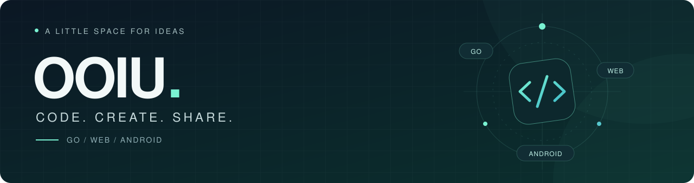

  

<h1 align="center">你好，我是 OOIU 👋</h1>

把日常想法，写成实用的小工具。

  <a href="https://www.ooiu.cn">个人网站</a> &nbsp; / &nbsp;
  <a href="https://github.com/OOIUa?tab=repositories">开源项目</a> &nbsp; / &nbsp;
  <a href="mailto:ooiua.dev@gmail.com">联系我</a>

 

### 关于这里

这里放着我的 Go 服务、Android 应用和 Web 项目：有聚合信息的 API，也有日常使用的小应用和插件。喜欢从具体需求出发，把一个想法慢慢做成能用的东西。

### 精选项目

<table>
  <tr>
    <td width="50%" valign="top">
      <h3><a href="https://github.com/OOIUa/DailyHot">DailyHot</a></h3>
      
把各个平台的热门内容汇集到一起，提供统一的 JSON / RSS 接口。

      
<code>Go</code> <code>API</code> <code>RSS</code>

    </td>
    <td width="50%" valign="top">
      <h3><a href="https://github.com/OOIUa/hongguo-android">Hongguo Android</a></h3>
      
使用 Jetpack Compose 与 Media3 构建的原生 Android 短剧客户端。

      
<code>Kotlin</code> <code>Compose</code> <code>Media3</code>

    </td>
  </tr>
  <tr>
    <td width="50%" valign="top">
      <h3><a href="https://github.com/OOIUa/rainyun-ros-upload-wp">雨云对象存储 · WordPress</a></h3>
      
将 WordPress 媒体库自动同步到雨云对象存储，兼容 S3 协议。

      
<code>PHP</code> <code>WordPress</code> <code>S3</code>

    </td>
    <td width="50%" valign="top">
      <h3><a href="https://github.com/OOIUa/cccyun-pay-pro-template">彩虹易支付 Pro · 页面模板</a></h3>
      
围绕支付流程制作的页面模板，涵盖首页、收银台和支付测试页。

      
<code>HTML</code> <code>CSS</code> <code>JavaScript</code>

    </td>
  </tr>
</table>

<a href="https://github.com/OOIUa?tab=repositories">查看全部项目 →</a>

### 技术工具箱

| 方向 | 技术与工具 |
| :--- | :--- |
| 服务与脚本 | `Go` · `Python` · `Node.js` · `PHP` |
| Web 界面 | `TypeScript` · `JavaScript` · `Vue` · `React` · `HTML / CSS` |
| Android | `Kotlin` · `Jetpack Compose` · `Media3` |
| 数据与协作 | `MySQL` · `MongoDB` · `Git` |

 

  保持好奇，慢慢做出好用的东西。 
  Thanks for stopping by.

